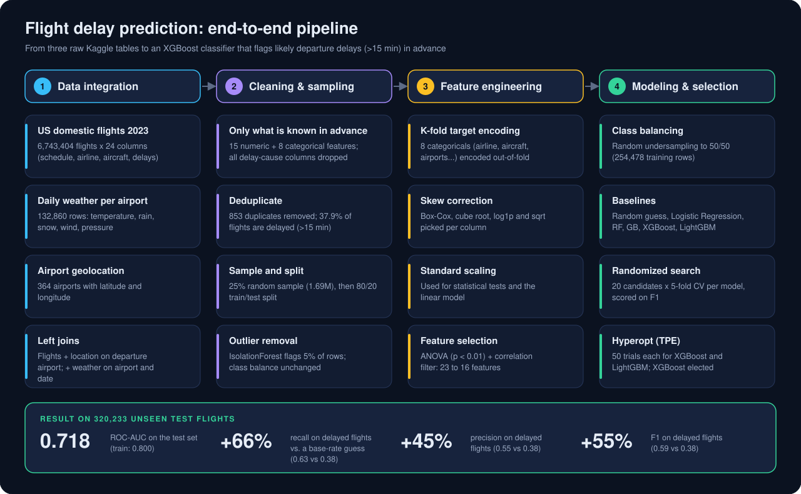

# Flight Delay Prediction

**Predicting whether a US domestic flight will leave more than 15 minutes late, using only information available well before departure.**


Final individual project of the Data Science & AI Bootcamp at The Bridge (2025).


## At a glance

Flight delays cost airlines, airports and passengers money and goodwill, and the earlier a delay is anticipated, the cheaper it is to absorb. This project builds a binary classifier on **6.7 million 2023 US flights** joined with daily weather and airport location data. It deliberately uses **only pre-flight information**: schedule, route, aircraft and weather. No real-time or post-event delay data is used, so flights can be scored before the day of operation.

| Test set: 320,233 unseen flights | Model | Base-rate guess |
|---|---|---|
| ROC-AUC | **0.718** | 0.50 |
| Recall on delayed flights | **0.63** (+66%) | 0.38 |
| Precision on delayed flights | **0.55** (+45%) | 0.38 |
| F1 on delayed flights | **0.59** (+55%) | 0.38 |

The elected model is **XGBoost tuned with Hyperopt**. It catches 63% of delayed flights, and 55% of the flights it flags are in fact delayed, against a 38% delay rate in the data.



## What makes it interesting

- **Built to avoid leakage.** Every column describing the delay itself (minutes, causes, previous-aircraft delay) is excluded, and categorical features are target-encoded **out-of-fold**. An earlier version that used the previous flight's delay scored higher (F1 on delayed flights about 0.62 vs 0.59) but was dropped because that value is not known in advance.
- **High-cardinality categoricals handled cleanly.** Thousands of aircraft tail numbers and hundreds of airports become one smoothed number each, instead of a huge one-hot matrix.
- **A careful, measurable selection process.** IsolationForest outlier removal, per-column skew correction, ANOVA plus a correlation filter (23 to 16 features), then a ladder of baselines, RandomizedSearchCV and Hyperopt, all compared on the same held-out flights.
- **A documented trail of experiments.** Seven earlier notebooks are kept in [`src/notebooks/archive`](src/notebooks/archive), each tied to the decision it informed.

The full methodology, results discussion and limitations are in the **[project report](docs/report.md)**.

## Tech stack

Python 3.12 · pandas · NumPy · scikit-learn · imbalanced-learn · XGBoost · LightGBM · Hyperopt · SciPy · Matplotlib · seaborn · Jupyter

## Repository structure

```text
.
├── docs/
│   ├── report.md                 # methodology, results, experiment log, limitations
│   ├── img/                      # diagrams and result figures used in the docs
│   └── diagrams/                 # scripts that rebuild docs/img
├── src/
│   ├── results_notebook/
│   │   ├── flight_delay_classification.ipynb   # ★ final, presented work
│   │   ├── requirements.txt                    # pinned Python 3.12 environment
│   │   ├── requirements-legacy-py39-gpu.txt    # original 2025 environment (rollback reference)
│   │   ├── environment-legacy-py39-gpu.yml
│   │   └── img/
│   ├── notebooks/archive/        # earlier experiments, kept as a record (01-07)
│   ├── models/best_model_xgb.pkl # elected, trained XGBoost model
│   ├── utils/User_Functions.py   # encoding, transformation and plotting helpers
│   ├── data_sample/              # 6,743-row sample of the merged data, for a quick look
│   └── data/                     # raw Kaggle CSVs go here (git-ignored)
├── LICENSE
└── README.md
```

## Getting started

**1. Clone and create the environment** (Windows, Python 3.12):

```powershell
git clone https://github.com/neural-insights/Project_Break_II_ML.git
cd Project_Break_II_ML
py -3.12 -m venv .venv
.venv\Scripts\python -m pip install -r src\results_notebook\requirements.txt
```

On macOS/Linux, use `python3.12 -m venv .venv` and `.venv/bin/python -m pip install -r src/results_notebook/requirements.txt`. On Windows, TensorFlow needs [long-path support](https://learn.microsoft.com/windows/win32/fileio/maximum-file-path-limitation#enable-long-paths-in-windows-10-version-1607-and-later) enabled.

**2. Download the data** from Kaggle: [2023 US Civil Flights, Delay, Meteo and Aircraft](https://www.kaggle.com/datasets/bordanova/2023-us-civil-flights-delay-meteo-and-aircraft/data) (CC0, about 1.2 GB). Create the folder `src/data/` and place these three files in it:

- `US_flights_2023.csv`
- `weather_meteo_by_airport.csv`
- `airports_geolocation.csv`

**3. Run the notebook** [`src/results_notebook/flight_delay_classification.ipynb`](src/results_notebook/flight_delay_classification.ipynb) in Jupyter or VS Code with the `.venv` kernel. Paths are relative to the notebook's folder. The hyperparameter searches take a while: Hyperopt alone ran for about 16 minutes on the original machine.

> **GPU note:** the XGBoost Hyperopt cell was written for an NVIDIA GPU (`tree_method='gpu_hist', gpu_id=0`). The pip XGBoost wheel bundles CUDA, so only an NVIDIA driver is needed, not a CUDA toolkit. On a machine without an NVIDIA GPU that cell stops with *"Must have at least one device"*: change those two arguments in `create_model_xgb` to `tree_method='hist'` to train on the CPU (slower). The saved model loads and predicts on any machine.

To use the trained model without retraining, load `src/models/best_model_xgb.pkl` and pass a frame with the 16 features listed in the [report](docs/report.md#5-feature-selection), prepared with the same steps.

<details>
<summary><b>Data dictionary</b> (raw columns used by the model)</summary>

| Field | Description | Example |
|---|---|---|
| Day_Of_Week | Day of the week (1 = Monday) | 3 |
| Month, Day | Month and day of month, split from `FlightDate` | 11, 28 |
| Airline | Operating airline | Delta Air Lines Inc |
| Tail_Number | Aircraft registration | N905DN |
| Dep_Airport / Arr_Airport | IATA code of departure / arrival airport | PDX / ATL |
| DepTime_label | Scheduled departure time slot | Morning |
| Flight_Duration | Scheduled duration in minutes | 276 |
| Distance_type | Distance band | Medium Haul <3000Mi |
| Manufacturer / Model | Aircraft manufacturer and model | BOEING / 737 NG |
| Aicraft_age | Aircraft age in years (column name as in the source) | 6 |
| LATITUDE / LONGITUDE | Departure airport coordinates | 45.59 / -122.60 |
| tavg, tmin, tmax | Daily average, min and max temperature (°C) at the departure airport | 21.3, 13.9, 31.1 |
| prcp, snow | Daily precipitation and snowfall (mm) | 0.0, 0.0 |
| wdir, wspd | Wind direction (°) and speed (km/h) | 313, 11.9 |
| pres | Air pressure (hPa) | 1012.9 |
| **Dep_Delay_Tag** | **Target:** 1 if departure delay > 15 min, else 0 | 0 |

The source also contains delay minutes and delay causes (`Dep_Delay`, `Arr_Delay`, `Delay_Carrier`, `Delay_Weather`, `Delay_NAS`, `Delay_Security`, `Delay_LastAircraft`). They are deliberately **not** used as inputs, because they are only known after the fact.

</details>

## License and acknowledgements

The code is released under the [MIT License](LICENSE). The dataset by its Kaggle author is published under **CC0: Public Domain** and is not redistributed here, apart from the small sample in `src/data_sample/`.

Developed as the capstone project of The Bridge Data Science & AI Bootcamp. Feedback and suggestions are welcome through [issues](https://github.com/neural-insights/Project_Break_II_ML/issues).
