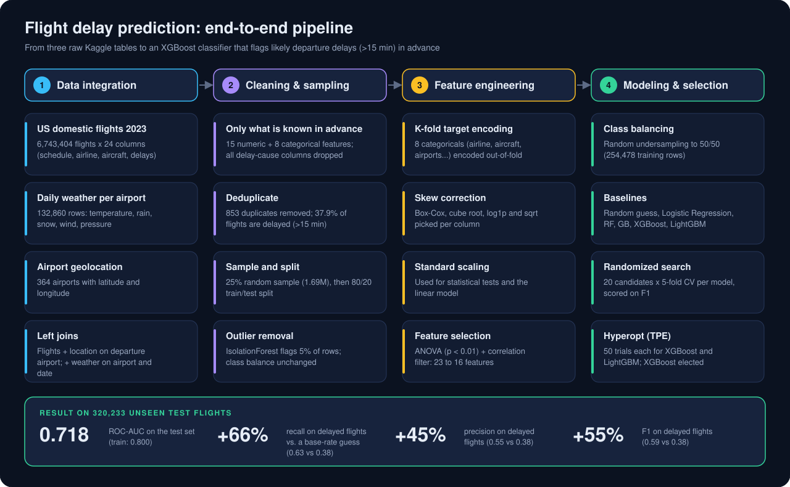
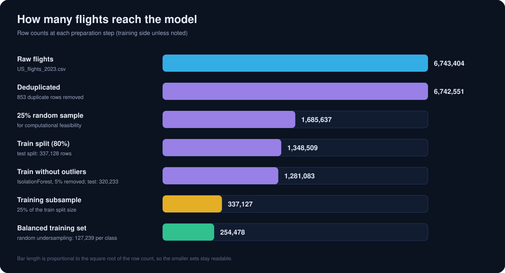
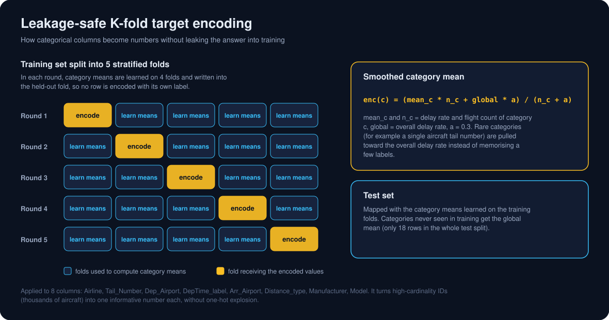
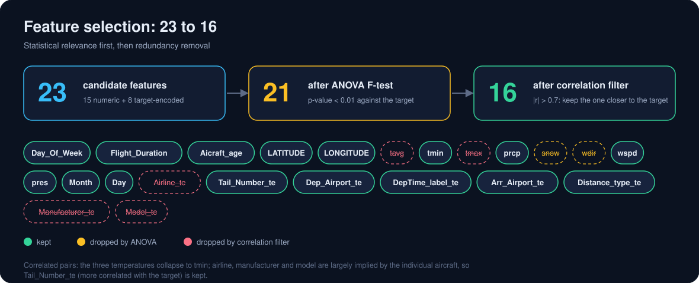
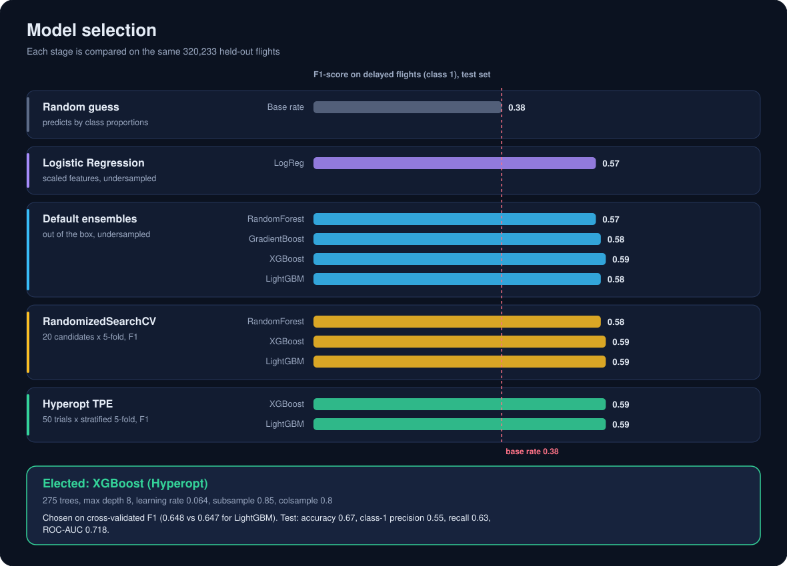
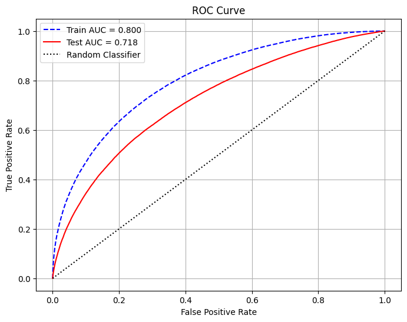
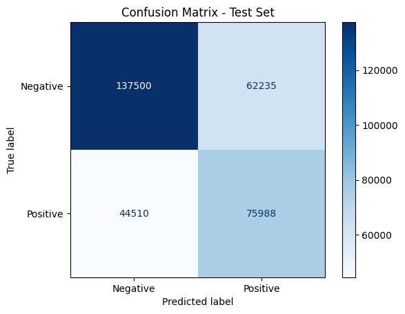
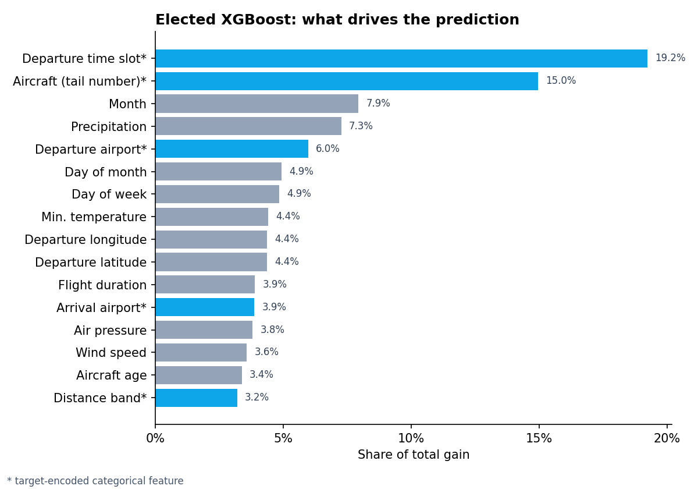
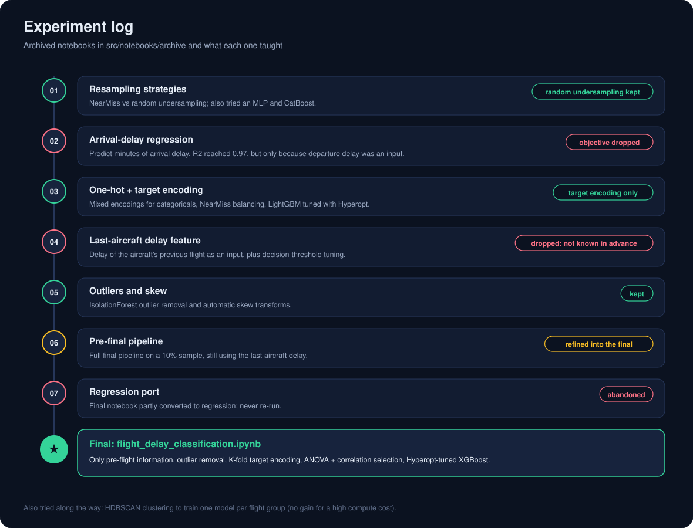

# Flight Delay Prediction: Project Report

Capstone project, Data Science & AI Bootcamp at The Bridge (2025).
Final notebook: [`src/results_notebook/flight_delay_classification.ipynb`](../src/results_notebook/flight_delay_classification.ipynb)

## Contents

1. [Executive summary](#executive-summary)
2. [The problem](#the-problem)
3. [Data](#data)
4. [Methodology](#methodology)
5. [Results](#results)
6. [Experiment log](#experiment-log)
7. [Challenges and key decisions](#challenges-and-key-decisions)
8. [Limitations and next steps](#limitations-and-next-steps)

## Executive summary

**Goal:** flag, well before departure, the US domestic flights that are likely to leave more than 15 minutes late.

**Constraint:** use only information available in advance: the schedule, route, airline, aircraft and the weather forecast for the day. Real-time signals, such as the delay of the aircraft's previous flight, are excluded on purpose. They would raise the scores but make the model useless for planning.

**Outcome:** an XGBoost classifier tuned with Hyperopt and evaluated on 320,233 held-out flights:

| Metric (test set) | Model | Base-rate guess | Improvement |
|---|---|---|---|
| Precision, delayed flights | 0.55 | 0.38 | +45% |
| Recall, delayed flights | 0.63 | 0.38 | +66% |
| F1, delayed flights | 0.59 | 0.38 | +55% |
| ROC-AUC | 0.718 | 0.50 | |
| Accuracy | 0.67 | 0.53 | |

In plain terms, the model catches about **two in three delayed flights**, and when it raises a flag the flight is delayed **55% of the time**, against 38% if flights were flagged at random. At the scale of millions of flights a year, that is a useful early-warning signal for staffing, gate planning and passenger communication. It does not replace operational, real-time systems.

## The problem

Delays hurt everyone involved. Passengers miss connections, crew and ground staff are redeployed at short notice, and airlines pay airport fees, compensation and rebooking costs. The earlier a delay is anticipated, the cheaper it is to absorb.

Many causes are unpredictable: severe weather events, technical failures, security incidents. But part of the risk follows patterns that airports and airlines can see in advance, such as specific routes, time slots, aircraft, seasons and weather conditions. This project tests how much of that predictable part can be captured from pre-flight data alone.

The target is `Dep_Delay_Tag`: **1** if the flight departs more than 15 minutes after schedule, **0** otherwise. After cleaning, 37.9% of flights are delayed.

## Data

Source: [2023 US Civil Flights, Delay, Meteo and Aircraft](https://www.kaggle.com/datasets/bordanova/2023-us-civil-flights-delay-meteo-and-aircraft/data) on Kaggle (CC0).

| Table | Rows | Content |
|---|---|---|
| `US_flights_2023.csv` | 6,743,404 | One row per flight: date, airline, aircraft, airports, schedule, delays and causes |
| `weather_meteo_by_airport.csv` | 132,860 | Daily weather per airport: temperatures, precipitation, snow, wind, pressure |
| `airports_geolocation.csv` | 364 | Airport coordinates |

Flights are joined to the departure airport's location, and to that airport's weather on the flight date (left joins). The date is split into month and day of month.

## Methodology

### 1. Feature scope: only what is known in advance

From the merged table, the model may use 15 numeric features (day of week, month, day, scheduled duration, aircraft age, airport coordinates, seven weather variables) and 8 categorical ones (airline, tail number, departure and arrival airports, departure time slot, distance band, manufacturer, model). Delay minutes and delay causes are excluded because they describe the outcome.

### 2. Cleaning, sampling and splitting

- 853 exact duplicates removed.
- A 25% random sample (1,685,637 flights) keeps training times practical, then an 80/20 train/test split.
- **IsolationForest** (5% contamination), fitted on the training numerics, removes outliers from both sets. The delayed share barely moves (37.9% to 37.7%), so the removal is not biased toward either class.

### 3. Leakage-safe target encoding

High-cardinality columns such as tail number (thousands of aircraft) and airports would explode under one-hot encoding. Each category is instead replaced by its **smoothed delay rate**, computed out-of-fold with 5 stratified folds so that no training row sees its own label. Smoothing (a = 0.3) pulls rare categories toward the global rate. Notebook 03 in the archive compared this with a mixed one-hot approach before target encoding alone was kept.

### 4. Skew correction and scaling

`suggest_best_transformations` tries square root, cube root, log1p and Box-Cox on every continuous column whose skewness exceeds 0.5, and keeps the one closest to zero skew. The result: Box-Cox for flight duration, cube root for precipitation, log1p for snow and square root for wind speed. Standard scaling is used for the statistical tests and the logistic regression. Tree models use the unscaled values.

### Feature selection

1. **ANOVA F-test** (p < 0.01) removes snow and wind direction: 23 to 21 features.
2. **Correlation filter:** for each pair with |r| > 0.7, keep the feature more correlated with the target. That drops average and maximum temperature (tmin kept) and airline, manufacturer and model (largely implied by the individual aircraft): 21 to 16 features.

Final inputs: `Day_Of_Week, Flight_Duration, Aicraft_age, LATITUDE, LONGITUDE, tmin, prcp, wspd, pres, Month, Day, Tail_Number_te, Dep_Airport_te, DepTime_label_te, Arr_Airport_te, Distance_type_te`.

A clustering approach, inspired by [a 2024 Scientific Reports article](https://www.nature.com/articles/s41598-024-55217-z) that trains one model per density-based cluster, was also tested with HDBSCAN. It brought no gain for a large compute cost, so it was not kept.

### 5. Class balancing and model selection

- The training set (337,127 rows) is balanced with **random undersampling** to 127,239 flights per class. Notebook 01 compared this with NearMiss.
- **F1 is the selection metric.** Missing a delay and raising a false alarm are both costly: false alarms divert attention from the flights that matter. Both classes are weighted equally. A business could shift this toward recall instead.
- Baselines: a random guess at the class proportions, then logistic regression, then default Random Forest, Gradient Boosting, XGBoost and LightGBM.
- **RandomizedSearchCV** (20 candidates, 5-fold) on Random Forest, XGBoost and LightGBM, followed by **Hyperopt (TPE, 50 trials, stratified 5-fold)** around the best regions for XGBoost and LightGBM.
- **XGBoost wins narrowly** on cross-validated F1 (0.648 vs 0.647). Final hyperparameters: 275 trees, max depth 8, learning rate 0.064, subsample 0.85, column sample 0.8.

## Results

| | Predicted on time | Predicted delayed |
|---|---|---|
| **Actually on time** (199,735) | 137,500 | 62,235 |
| **Actually delayed** (120,498) | 44,510 | **75,988** |

**Reading the results**

- The **departure time slot** and the **individual aircraft** carry the most signal. Delays accumulate over the day, and some aircraft or rotations are chronically late. **Month** and **precipitation** follow, capturing seasonality and weather.
- Train AUC (0.800) is above test AUC (0.718). Some overfitting remains, but the test score is stable across all tuned models (class-1 F1 of 0.58–0.59). That suggests the limit is the information available before departure, not the choice of algorithm.
- The gains are measured against the base rate, the natural benchmark for a planner who has no model.

## Experiment log

All earlier attempts are kept, unchanged, in [`src/notebooks/archive`](../src/notebooks/archive). They are a record of the process: their paths assume the repository root, and some read intermediate files that are no longer present.

| Notebook | What it tried | What it taught |
|---|---|---|
| [01_baseline_resampling_strategies](../src/notebooks/archive/01_baseline_resampling_strategies.ipynb) | NearMiss vs random undersampling; MLP and CatBoost | Random undersampling was carried forward: simpler and fast at this scale |
| [02_arrival_regression_with_departure_delay](../src/notebooks/archive/02_arrival_regression_with_departure_delay.ipynb) | Regression of arrival-delay minutes (second objective) | R² ≈ 0.97, but only because departure delay is an input, so it is not useful in advance. The objective was dropped. |
| [03_onehot_plus_target_encoding](../src/notebooks/archive/03_onehot_plus_target_encoding.ipynb) | One-hot for low-cardinality columns plus target encoding | Target encoding alone is enough |
| [04_last_aircraft_delay_feature](../src/notebooks/archive/04_last_aircraft_delay_feature.ipynb) | Previous-flight delay as a feature; threshold tuning | Raises F1 on delayed flights to about 0.62, but the value is not known in advance, so it was removed |
| [05_outlier_removal_skew_transforms](../src/notebooks/archive/05_outlier_removal_skew_transforms.ipynb) | IsolationForest and automatic skew transforms | Both kept in the final pipeline |
| [06_prefinal_with_last_aircraft_delay](../src/notebooks/archive/06_prefinal_with_last_aircraft_delay.ipynb) | Final pipeline on a 10% sample, still with previous-flight delay | Refined into the final notebook |
| [07_arrival_regression_unfinished](../src/notebooks/archive/07_arrival_regression_unfinished.ipynb) | Port of the final notebook to regression | Never re-run; its outputs are stale (see the note at its top) |

## Challenges and key decisions

- **Resisting leakage.** The most predictive columns in the dataset are delay minutes and causes, which are only known afterwards. Keeping them out, including the tempting previous-aircraft delay (F1 on delayed flights about 0.62 with it, 0.59 without), cost accuracy but is what makes the model usable for planning.
- **Scale.** 6.7 million rows and high-cardinality categoricals forced choices: sampling, out-of-fold target encoding instead of one-hot, and GPU-accelerated boosting during tuning.
- **Imbalance.** With 38% delayed flights, accuracy is misleading. Balancing the training set and selecting on F1 keeps the minority class in focus.
- **Honest comparison.** Every candidate is judged against a base-rate benchmark on the same held-out flights.

## Limitations and next steps

- **Random split across 2023.** Training and test flights come from the same days. A time-based split (train on January–September, test on October–December) would better reflect real use and probably lower the scores somewhat.
- **Weather is observed, not forecast.** The daily weather is the measured weather for the flight date, used as a proxy for the forecast that would be available in advance.
- **Encoding details.** Test-set categories are mapped with the means from the training folds rather than a separate refit on the full training set. This is a minor variance, not a leak.
- **Narrow search spaces.** The Hyperopt ranges were narrowed by hand around the RandomizedSearch results, and the LightGBM Hyperopt run maps two choice indices to a different list than its search space defines. This does not affect the elected XGBoost model.
- **Next steps:** time-based validation; route- and hub-level aggregates (historical delay rate per route and hour); decision thresholds tuned to a cost model; SHAP explanations per flight; and a small API to score a day's schedule.
